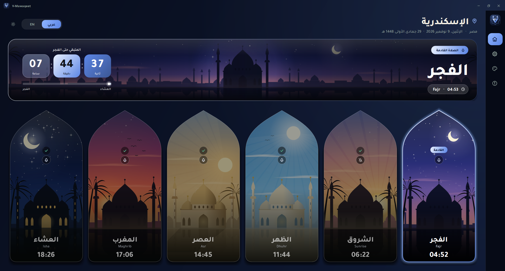
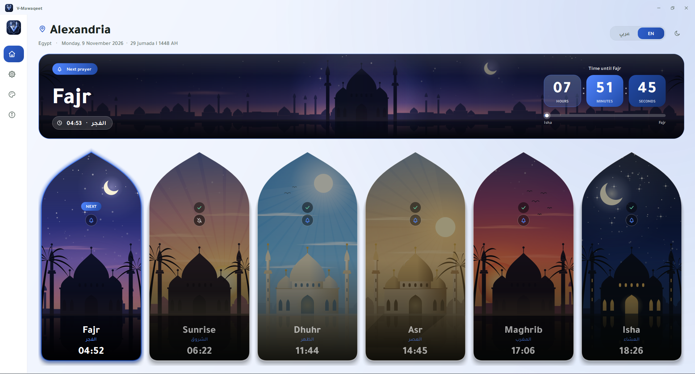
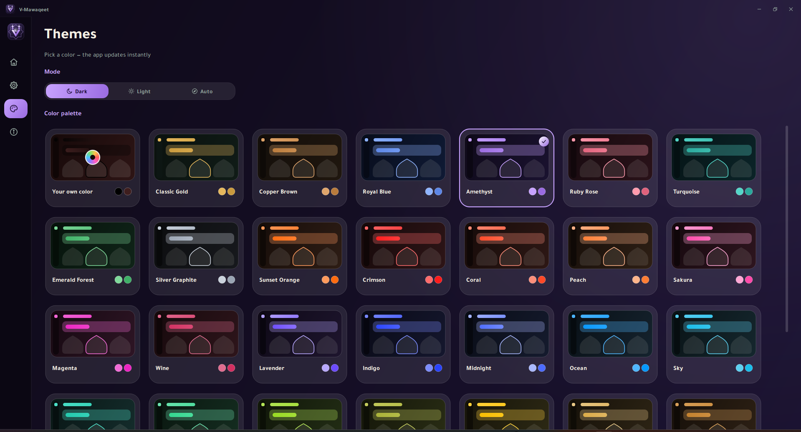
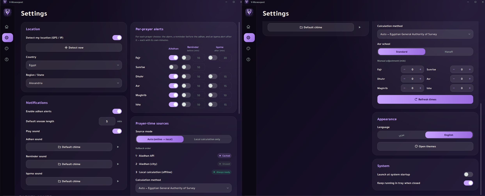
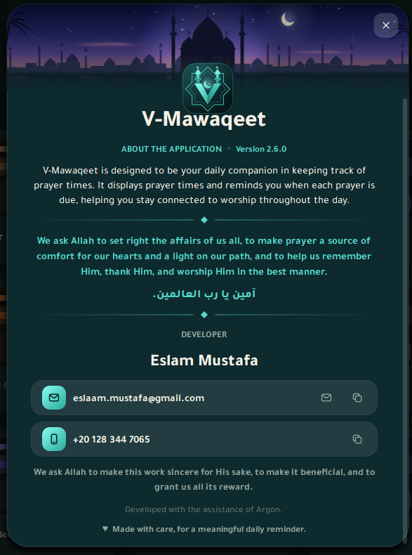
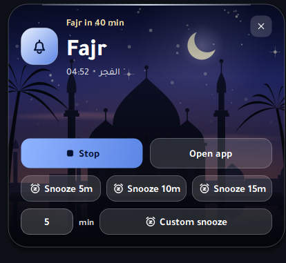
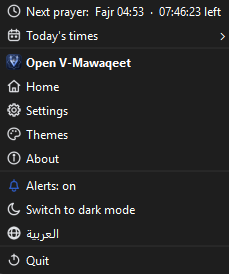
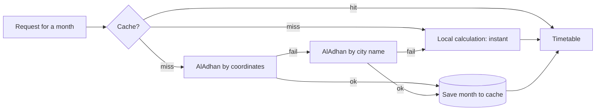
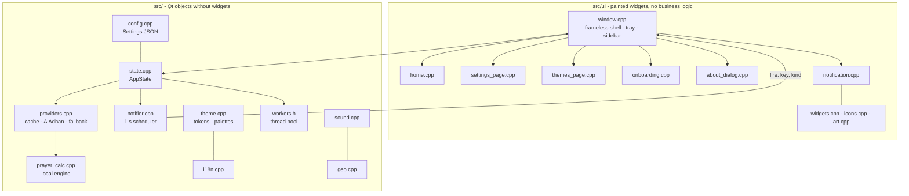

<div align="center">


# V-Mawaqeet &nbsp;·&nbsp; مواقيت

**A premium, bilingual desktop prayer-times app - smart reminders, iqama alerts, 32+ themes.**
Built with C++17 and Qt 6. Arabic (true RTL) and English. Windows & Linux.




</div>

---

## Table of contents

1. [Highlights](#highlights)
2. [Screenshots](#screenshots)
3. [Features in detail](#features-in-detail)
4. [Quick start](#quick-start) - [Windows](#windows) · [Linux](#linux) · [macOS](#macos)
5. [Build a standalone application](#build-a-standalone-application) - [Windows `.exe` + installer](#windows-exe--installer) · [Linux binary + app-menu entry](#linux-binary--app-menu-entry)
6. [Using the app](#using-the-app)
7. [Configuration reference](#configuration-reference)
8. [Prayer-time engine](#prayer-time-engine)
9. [Architecture](#architecture)
10. [Design system](#design-system)
11. [Testing](#testing)
12. [Troubleshooting](#troubleshooting)
13. [Privacy & network use](#privacy--network-use)
14. [Known limitations](#known-limitations)
15. [Releasing](#releasing) · [Contributing](#contributing) · [Credits & licenses](#credits--licenses) · [Author](#author)

---

## Highlights

- **Never blocks, never empty.** Times appear instantly from a cache or a built-in astronomical engine; the online source refreshes in the background. Offline works out of the box.
- **Smart notifications.** Per-prayer **adhan alarm**, **reminder before** the adhan (own minutes per prayer), **iqama alert** after it (own minutes per prayer), **snooze** with any number of minutes, and a separate sound file for each type.
- **Premium look.** Frameless window, hand-painted widgets (no stock OS controls), glass surfaces, soft shadows, animated transitions, procedurally painted illustration for every prayer.
- **32 themes + your own colour.** Dark / Light / Auto, each palette generated for both modes. The logo, tray icon, countdown and pop-ups follow the theme.
- **True bilingual UI.** Arabic switches the *whole layout* to right-to-left, not just the text. Live language switching, no restart.
- **Global coverage.** 250 countries, 4,144 regions with Arabic & English names; 23 calculation methods with an automatic per-country default.
- **Lives in the tray.** Live countdown, today's times, quick navigation and switches right from the tray menu.
- **~5,000 lines of readable, modern C++17.** Small modular headers and sources, no external third-party dependencies beyond Qt 6, native compilation for maximum speed and minimal memory footprint.

## Screenshots

| | |
|---|---|
|  |  |
| *Light mode · English · Royal Blue palette* | *Themes page - 32 palettes + custom colour* |
|  |  |
| *Settings - per-prayer alarm / reminder / iqama* | *About dialog* |


*Notifications use the prayer's own scene as background. Left: adhan with quick and custom snooze. Right: compact iqama alert.*


*Tray menu (English / Arabic): live countdown, today's times, navigation, alerts, theme & language switches.*

> I Hope i have some time to add the screenshots.

## Features in detail

### Prayer times
- Fajr, Sunrise, Dhuhr, Asr, Maghrib, Isha with Gregorian **and Hijri** date.
- Source chain: **cache → AlAdhan API (coordinates) → AlAdhan API (city) → local astronomical calculation.** Each online call has a timeout and retry with exponential back-off, always on a worker thread.
- **23 calculation methods** (Egyptian, Umm Al-Qura, MWL, ISNA, Karachi, Kuwait, Qatar, Gulf, Dubai, Jordan, Diyanet, Tehran, Jafari, Singapore, Malaysia, Indonesia, Morocco, Algeria, Tunisia, France, Russia, Portugal, Moonsighting) with a **default suggested per country**.
- Asr school (standard / Hanafi) and **manual ±minutes per prayer**.
- Month-long cache → the app keeps working without internet.

### Location
- **First run asks you**: detect automatically (OS location → IP fallback) or choose manually.
- Auto-detection maps coordinates to the **nearest region across all countries** (not the nearest country centre), and shows what it found so you can correct it.
- Searchable country and region pickers, Arabic and English names.

### Notifications
| Type | When | Configurable per prayer | Sound |
|---|---|---|---|
| **Adhan alarm** | at the prayer time | on / off | your file, or built-in chime |
| **Reminder** | *N* minutes **before** the adhan | on / off + minutes | your file, or built-in reminder tone |
| **Iqama** | *N* minutes **after** the adhan (not for sunrise) | on / off + minutes | your file, or built-in iqama tone |
| **Snooze** | after you snooze | - | uses the adhan sound |

- Pop-up (bottom-right, always on top) with the prayer's scene as backdrop; **Stop / Open app / Snooze 5-10-15 / Snooze any minutes**.
- Master switch, default snooze length, sound on/off, 90-second tolerance window (a late tick or a short sleep never swallows an alert).
- A **bell on every prayer card** mutes / unmutes that prayer's alarm in one click.

### Interface
- **Home**: header with city and Gregorian + Hijri date, a hero banner for the **next prayer** (its scene as backdrop + frosted HH:MM:SS tiles + progress bar), and six mihrab-shaped prayer cards (past = dimmed with ✓, next = glowing with a badge).
- **Friday**: the Dhuhr slot reads **Jumu'ah / الجمعة** automatically (by the selected place's local date).
- **Themes page**, **Settings page**, **About dialog**, toast messages, animated page and theme transitions.
- Hover-expanding icon sidebar, custom title bar, native-feeling resize and drag on a frameless window.

### System integration
- **System tray**: closing the window keeps the app running (optional). Tray menu: next-prayer countdown, today's times, Home / Settings / Themes / About, alerts on/off, cancel snooze, switch theme, switch language, quit. Tooltip shows time remaining.
- **Launch at system startup**: Windows Registry (`HKCU\...\Run`) and Linux XDG autostart (`~/.config/autostart/V-Mawaqeet.desktop`). `--minimized` starts hidden.
- **Single instance** guard (`QLockFile`).
- Errors are logged to `app.log`; settings are stored per user.

## Quick start

**Requirements:** A C++17 compiler (`MSVC 2019+`, `MinGW-w64`, `GCC 10+`, or `Clang 11+`), **CMake 3.16+** (or `qmake6`), and **Qt 6** (`Core`, `Gui`, `Widgets`, `Network`, plus `Multimedia` and optional `Positioning`). Internet access is needed only for the first live refresh (the app works offline).

```text
Qt6::Core, Gui, Widgets    UI, custom QPainter rendering, animations, IANA QTimeZone
Qt6::Network               HTTP client for the prayer-time and geolocation APIs
Qt6::Multimedia            Audio playback with fade-in (QMediaPlayer + QAudioOutput)
Qt6::Positioning           Optional OS GPS location detection
```

### Windows
```powershell
git clone https://github.com/<you>/V-Mawaqeet.git
cd V-Mawaqeet
.\build_windows.bat
.\build\Release\V-Mawaqeet.exe
```
> Or manually in a **Qt 6 Developer Command Prompt**:
> ```powershell
> mkdir build && cd build
> cmake -DCMAKE_PREFIX_PATH="C:/Qt/6.7.0/msvc2019_64" -DCMAKE_BUILD_TYPE=Release ..
> cmake --build . --config Release --parallel
> windeployqt Release\V-Mawaqeet.exe
> ```
> You can also open `CMakeLists.txt` or `V-Mawaqeet.pro` directly in **Qt Creator** and press **Run**.

### Linux
1. Install a C++ compiler, CMake, and the Qt 6 development & runtime libraries:

   | Distro | Command |
   |---|---|
   | Ubuntu / Debian | `sudo apt install build-essential cmake qt6-base-dev qt6-multimedia-dev qt6-positioning-dev libgl1-mesa-dev libxcb-cursor0 libxkbcommon-x11-0` |
   | Fedora | `sudo dnf install gcc-c++ cmake qt6-qtbase-devel qt6-qtmultimedia-devel qt6-qtpositioning-devel xcb-util-cursor libxkbcommon-x11` |
   | Arch | `sudo pacman -S base-devel cmake qt6-base qt6-multimedia qt6-positioning xcb-util-cursor libxkbcommon-x11` |

2. Build & Run:
   ```bash
   git clone https://github.com/<you>/V-Mawaqeet.git
   cd V-Mawaqeet
   chmod +x build_linux.sh
   ./build_linux.sh
   ./build/V-Mawaqeet
   ```
- **Tray on GNOME** needs the *AppIndicator and KStatusNotifierItem Support* extension. KDE, XFCE, Cinnamon, MATE work out of the box.
- **Launch at login** works natively on both Windows (Registry Run key) and Linux (creates `~/.config/autostart/V-Mawaqeet.desktop` with `--minimized`).
- Designed for X11 and Wayland (the frameless window uses Qt's native system move/resize). Reports are welcome.

### macOS
The code is cross-platform C++17 / Qt 6 and the build steps are the same as Linux (`cmake -B build && cmake --build build`), but **macOS has not been tested** and there is no `.app` bundle packaging for it yet.

## Build a standalone application

Native C++ binaries compile directly for the target OS: **build on the OS you target.**

### Windows `.exe` + installer
```powershell
.\build_windows.bat
```
Result:
```text
build\Release\
├── V-Mawaqeet.exe        <- double-click (icon = the V-minaret logo embedded via app.rc)
├── Qt6Core.dll, Qt6Gui.dll, Qt6Widgets.dll, Qt6Network.dll, Qt6Multimedia.dll ...
└── assets\               <- automatically copied next to the executable by CMake
```

| Command | What you get |
|---|---|
| `.\build_windows.bat` | Release build in `build\Release\V-Mawaqeet.exe` + `assets\` + Qt runtime DLLs via `windeployqt` |
| `cmake -B build -DCMAKE_BUILD_TYPE=Release && cmake --build build --config Release` | CMake Release build (copies `assets\` next to the `.exe` automatically) |
| `qmake6 V-Mawaqeet.pro && nmake` (or `mingw32-make`) | Alternative build using `qmake6` |

What the build does: compiles all 26 C++17 source files → **embeds `assets/icon.ico` into `V-Mawaqeet.exe`** (`app.rc`) → copies `assets/` next to the binary → runs `windeployqt` to bundle the required Qt 6 DLLs and plugins.

**Make a real installer (optional).** Install [Inno Setup 6](https://jrsoftware.org/isinfo.php), build once with `build_windows.bat`, then compile `packaging/windows/installer.iss` (open it and press *Compile*, or `iscc packaging\windows\installer.iss`). You get `dist\installer\V-Mawaqeet-Setup-<version>.exe` with Start-menu entry, optional desktop shortcut and uninstaller. *The script is provided as a template and has not been run on every Windows setup.*

**Tips**
- Always run `windeployqt Release\V-Mawaqeet.exe` before distributing the folder so machines without Qt installed have the `platforms\qwindows.dll` and `tls\` plugins.
- Unsigned executables trigger **SmartScreen** the first time. Code-signing certificates remove the warning. But of course I will not buy one :D
- If you change `assets/icon.ico` and Explorer keeps showing an old icon after rebuilding, it is the Windows icon cache: restart Explorer or copy the exe elsewhere.

### Linux binary + app-menu entry
```bash
./build_linux.sh                       # -> build/V-Mawaqeet  (+ build/assets/)
sudo cmake --install build --prefix /usr/local
```
Or install for the current user without root:
```bash
cmake --install build --prefix ~/.local
```
This installs the binary to `~/.local/bin/V-Mawaqeet` and assets to `~/.local/share/V-Mawaqeet/assets`.

To distribute: `tar -czf V-Mawaqeet-linux-x86_64.tar.gz -C build V-Mawaqeet assets`. Build on the **oldest** distribution you want to support (glibc compatibility). An AppImage can be produced with `linuxdeploy` + `linuxdeploy-plugin-qt`.

## Using the app

**First run.** A short wizard asks for language → how to find your location (automatic or manual) → calculation method (a sensible default for your country is pre-selected) → theme. Nothing else is needed.

**Home.**
- The hero banner shows the next prayer, the frosted **hours / minutes / seconds** tiles and a progress bar from the previous prayer to the next.
- Tap the **bell** on a card to mute or unmute that prayer's alarm.
- Header: language switch (عربي | EN) and a light/dark button.

**Settings.**
| Section | What you can do |
|---|---|
| Location | automatic detection (shows the detected place), or pick country and region |
| Notifications | master switch, default snooze minutes, sound on/off, files for adhan / reminder / iqama (with preview and reset) |
| Per-prayer alerts | for every prayer: alarm on/off · reminder on/off + minutes before · iqama on/off + minutes after |
| Sources | auto (online → local) or local only; live status badges; calculation method; Asr school; ±minutes per prayer; *Refresh times* |
| Appearance | language, open the Themes page |
| System | launch at system startup, keep running in tray when closed |

**Themes.** Choose *Dark*, *Light* or *Auto* (follows the OS), then one of 32 palettes - or **Your own colour** (any colour; dark and light variants are generated for you).

**Tray menu.** Right-click the tray icon: live countdown to the next prayer, *Today's times*, Open / Home / Settings / Themes / About, alerts on-off, cancel snooze, switch theme, switch language, Quit.

**Command line.** `./V-Mawaqeet --minimized` (or `V-Mawaqeet.exe --minimized`) starts hidden in the tray.

## Configuration reference

Settings are plain JSON, written on every change (100% compatible between the Python and C++ editions).

| OS | Folder |
|---|---|
| Windows | `%APPDATA%\V-Mawaqeet\` |
| Linux | `~/.config/V-Mawaqeet/` (respects `XDG_CONFIG_HOME`) |
| macOS | `~/Library/Application Support/V-Mawaqeet/` |

Inside: `config.json` · `cache\` (monthly prayer-time files) · `app.log` · `app.lock`. **Reset the app** by closing it and deleting the folder.

| Key | Default | Meaning |
|---|---|---|
| `first_run` | `true` | show the onboarding wizard |
| `language` | `"ar"` | `ar` or `en` |
| `theme` / `palette` / `custom_accent` | `"dark"` / `"gold"` / `"#E6B85C"` | `dark`·`light`·`auto`; a palette key or `custom`; colour used by `custom` |
| `auto_location` | `false` | detect location instead of the chosen region |
| `country_code` / `region_index` | `"EG"` / `0` | selected country (ISO-2) and region index |
| `lat` / `lng` / `tz` | Alexandria | coordinates and IANA time zone actually used |
| `method` | `"auto"` | calculation method key or `auto` (per-country default) |
| `asr_school` | `0` | `0` standard, `1` Hanafi |
| `offsets` | all `0` | manual minutes per prayer |
| `source_mode` | `"auto"` | `auto` (online → local) or `offline` |
| `notify` | `true` | master switch for all alerts |
| `alerts` | all on except sunrise | adhan alarm per prayer |
| `reminders` / `reminder_min` | all off / `10` | reminder per prayer / minutes **before** |
| `iqama` / `iqama_min` | all off / fajr 20, dhuhr 15, asr 15, maghrib 10, isha 15 | iqama per prayer / minutes **after** |
| `snooze_minutes` | `5` | default value in the snooze box |
| `sound_enabled` | `true` | play sounds |
| `adhan_sound` / `pre_sound` / `iqama_sound` | `""` | file path, empty = built-in sound |
| `autostart` | `false` | launch at system startup |
| `minimize_to_tray` | `true` | closing the window hides it |

Older settings files are **migrated automatically** (e.g. the former single global reminder becomes per-prayer reminders). `notify_sunrise` and `pre_reminder` are legacy keys kept only for that migration.

## Prayer-time engine


- The UI is filled **immediately** from cache or the local engine; the online fetch runs in the background and replaces the data when it arrives (with a toast).
- The local engine is a C++17 implementation of the standard solar-position algorithm (as described by PrayTimes.org): Fajr/Isha by twilight angle (or fixed minutes after Maghrib for Umm Al-Qura-style methods), Asr by shadow factor, a **one-seventh-of-the-night rule** when twilight never ends at high latitudes. In a spot check for Alexandria it matched AlAdhan's Sunrise, Asr and Maghrib to the minute.
- Hijri dates come from AlAdhan when online and from a tabular algorithm when offline (can differ by a day from moon sighting).
- Always compare with your local religious authority; use *manual adjustment* if your mosque differs by a minute or two.

<details>
<summary><b>Calculation methods</b> (key · AlAdhan id · Fajr° · Isha)</summary>

| Key | Id | Fajr | Isha | Name |
|---|---|---|---|---|
| `egypt` | 5 | 19.5° | 17.5° | Egyptian General Authority of Survey |
| `ummalqura` | 4 | 18.5° | 90 min | Umm Al-Qura University, Makkah |
| `mwl` | 3 | 18° | 17° | Muslim World League |
| `isna` | 2 | 15° | 15° | Islamic Society of North America |
| `karachi` | 1 | 18° | 18° | University of Islamic Sciences, Karachi |
| `kuwait` | 9 | 18° | 17.5° | Kuwait |
| `qatar` | 10 | 18° | 90 min | Qatar |
| `gulf` | 8 | 19.5° | 90 min | Gulf Region |
| `dubai` | 16 | 18.2° | 18.2° | Dubai |
| `jordan` | 23 | 18° | 18° | Jordan Ministry of Awqaf |
| `turkey` | 13 | 18° | 17° | Diyanet İşleri Başkanlığı |
| `tehran` | 7 | 17.7° | 14° | Institute of Geophysics, Univ. of Tehran |
| `jafari` | 0 | 16° | 14° | Shia Ithna-Ashari (Leva, Qum) |
| `singapore` | 11 | 20° | 18° | MUIS |
| `malaysia` | 17 | 20° | 18° | JAKIM |
| `indonesia` | 20 | 20° | 18° | Kemenag |
| `morocco` | 21 | 19° | 17° | Morocco |
| `algeria` | 19 | 18° | 17° | Algeria |
| `tunisia` | 18 | 18° | 18° | Tunisia |
| `france` | 12 | 12° | 12° | UOIF |
| `russia` | 14 | 16° | 15° | Spiritual Administration of Muslims of Russia |
| `portugal` | 22 | 18° | 77 min | Portugal |
| `moonsighting` | 15 | 18° | 18° | Moonsighting Committee Worldwide |

</details>

## Architecture



| Path | Responsibility |
|---|---|
| `src/main.cpp` | entry point: logging (`app.log`), single-instance lock (`QLockFile`), fonts, settings, window |
| `src/app_info.h` | application constants (`APP_NAME`, `APP_VERSION`, developer metadata) |
| `src/config.h` · `config.cpp` | `Settings` struct ⇄ JSON (`QJsonDocument`), with automatic v2.0/v2.2 migrations |
| `src/state.h` · `state.cpp` | `AppState`: location, timetable, snapshot of "next prayer", refresh, auto-location mapping |
| `src/providers.h` · `providers.cpp` | monthly cache + AlAdhan clients (`QNetworkAccessManager`) + fallback chain (runs on workers) |
| `src/prayer_calc.h/.cpp` · `hijri.h/.cpp` | local solar engine · tabular Hijri converter |
| `src/methods.h` · `methods.cpp` | 23 methods, per-country defaults |
| `src/notifier.h` · `notifier.cpp` | decides *when* adhan / reminder / iqama / snooze fire (pure logic, 1 s `QTimer`) |
| `src/workers.h` | `run_async<T>(fn, on_done)` via `QThreadPool` + `QMetaObject::invokeMethod` on the GUI thread |
| `src/sound.h` · `sound.cpp` | `QMediaPlayer` + `QAudioOutput` with fade-in; audio backend created lazily |
| `src/geo.h/.cpp` · `src/ui/locate.h/.cpp` | OS location (`QtPositioning`) → IP geolocation fallback |
| `src/locations.h/.cpp` + `assets/data/locations.json` | 250 countries / 4,144 regions, AR + EN |
| `src/theme.h` · `theme.cpp` | design tokens, 32 generated palettes, QSS |
| `src/i18n.h` · `i18n.cpp` | AR / EN string table, RTL helpers, Jumu'ah logic |
| `src/autostart.h` · `autostart.cpp` | launch at login on Windows (Registry Run key) and Linux (`~/.config/autostart/*.desktop`) |
| `src/ui/widgets.h` · `widgets.cpp` | Card, Label, Button, IconButton, Toggle, Segmented, Stepper, MinutesInput, StatusBadge, SearchCombo, Toast, SlideStack |
| `src/ui/icons.h` · `icons.cpp` | all 29 vector icons **and the 3D logo** drawn with `QPainter` |
| `src/ui/art.h` · `art.cpp` | the six prayer scenes (sky, sun/moon, mosque, palms, reflection) |
| `src/ui/home.h` · `home.cpp` | Home page, HeroCard, CountdownBlock, mihrab PrayerCards |
| `src/ui/settings_page.h` · `settings_page.cpp` | Settings page with responsive 1/2-column layout and per-prayer alert grid |
| `src/ui/themes_page.h` · `themes_page.cpp` | Themes gallery with live mini-window PaletteCards and custom colour picker |
| `src/ui/onboarding.h` · `onboarding.cpp` | 7-step first-run wizard |
| `src/ui/notification.h` · `notification.cpp` | frameless always-on-top notification popup with snooze controls |
| `src/ui/about_dialog.h` · `about_dialog.cpp` | in-window About dialog overlay with scene header and contact actions |
| `src/ui/window.h` · `window.cpp` | frameless window, title bar, sidebar, tray menu, theme / language rebuild |
| `CMakeLists.txt` · `V-Mawaqeet.pro` · `app.rc` | cross-platform CMake and qmake6 build definitions + Windows icon resource |

**Key design decisions**
- **Everything visible is painted** with `QPainter` instead of styled stock widgets → identical look on every OS, pixel-level control, easy animation.
- **Theme = data.** Every colour is a token; painted widgets read tokens at paint time. A theme/language switch rebuilds the pages behind a cross-fade.
- **Network and disk-heavy work never touches the UI thread** (`QThreadPool` + queued GUI callbacks).
- **Offline-first.** Show something instantly, improve it asynchronously.
- **Notifier is pure logic** (a 1 s timer comparing "now" to scheduled times).

## Design system

- **Palettes**: 8 hand-tuned + 24 generated from one accent via HSL, each with dark and light variants; `custom` generates a palette from any colour. Tokens: `bg0 bg1 bg2 surface border text text2 accent accent2 on_accent …`.
- **Typography**: [Tajawal](https://fonts.google.com/specimen/Tajawal) (static weights; Arabic + Latin), bundled in `assets/fonts/`.
- **Shape & motion**: radii 12–30 px, 8 px spacing grid, 160–320 ms ease-out transitions, layered soft shadows, glass surfaces in dark mode.
- **Imagery**: prayer illustrations are generated by code (layered sky → sun/moon → clouds → skyline → mosque → ground → palms → reflection), so they scale to any size and never ship as image files.
- **Logo**: drawn from the active palette (dark badge + metallic accent); same function feeds the sidebar, title bar, tray, About dialog and the `.ico`.
- **RTL**: Arabic sets Qt's layout direction to right-to-left; custom painting handles mirrored alignment explicitly.

## Testing

You can run the application in offscreen mode (`QT_QPA_PLATFORM=offscreen`) on headless CI servers, and verify all translation keys, calculation methods, Hijri dates, and visual scenes.

**Manual checklist**: real tray icon & menu, launch at startup, OS location permission prompt, actual audio output, high-DPI rendering, installer.

## Troubleshooting

| Symptom | Cause / fix |
|---|---|
| CMake cannot find `Qt6` on Windows | pass `-DCMAKE_PREFIX_PATH="C:/Qt/6.x.x/msvc2019_64"` to `cmake`, or run `build_windows.bat` from the **Qt 6 Command Prompt**. |
| Linux: *"could not load the Qt platform plugin xcb"* | install `libxcb-cursor0` (and the packages in the Linux table). `QT_DEBUG_PLUGINS=1 ./build/V-Mawaqeet` shows what is missing. |
| No tray icon on GNOME | install/enable the *AppIndicator and KStatusNotifierItem Support* extension. |
| No sound | check **Settings → Notifications → Play sound**; use the ▶ preview. Supported by Qt's FFmpeg/multimedia backend: mp3, wav, ogg, flac, m4a, aac. On a machine without an audio device the app stays silent instead of crashing (`VM_NO_AUDIO=1` forces silence). |
| Auto-detect picks a neighbouring city | IP geolocation is approximate and coordinates are region-level; near borders the nearest region can be across the line. Switch off auto-detect and choose manually. |
| Times differ by 1–2 minutes from my mosque | pick the method your authority uses, or add a manual ± adjustment per prayer. |
| Windows SmartScreen / antivirus warning | the executable is unsigned. Sign the binary if you distribute widely. |
| Old icon after rebuilding | Windows icon cache - restart Explorer or move the file. |
| App does not start the second time | single-instance guard. Close the running instance (tray → Quit) or delete `app.lock` in the data folder. |
| Want a clean slate | close the app and delete the data folder (see *Configuration reference*). |

## Privacy & network use

- **No telemetry, no accounts, no ads.** Everything is stored locally.
- Online requests are limited to: **api.aladhan.com** (your coordinates or city name, to fetch prayer times) and - only if you use automatic location - **ipwho.is / ip-api.com / ipapi.co** (your public IP is visible to them, as with any web request). Turn on *Local calculation only* in Settings → Sources for zero network use for prayer times.
- OS location (GPS / Wi-Fi) is requested only when you choose automatic detection.

## Known limitations

- Region coordinates are **governorate/state level**, not street level.
- The tray menu uses the OS native menu style (not themeable); **macOS untested**.
- Offline Hijri dates use a tabular algorithm.
- The **iqama sound** is one file for all prayers (minutes are per prayer).

## Releasing

1. Bump `APP_VERSION` in `src/app_info.h` and `project(V-Mawaqeet VERSION ...)` in `CMakeLists.txt`; update `CHANGELOG.md`.
2. On **Windows**: run `build_windows.bat` → (optional) compile the Inno Setup script → zip the release folder or ship the installer.
3. On **Linux**: run `./build_linux.sh` → `tar -czf V-Mawaqeet-linux-x86_64.tar.gz -C build V-Mawaqeet assets`.
4. Tag `vX.Y.Z`, create a GitHub Release, upload the artifacts and the changelog entry.

## Contributing

Issues and pull requests are welcome. Please keep the style: modern C++17, small modular files, **no stock-looking widgets**, every colour from a theme token, and every user-visible string in `src/i18n.cpp` in **both** languages.

## Credits & licenses

| Component | License |
|---|---|
| This project | **MIT** (`LICENSE`) |
| [Qt 6 (C++)](https://www.qt.io/) | LGPL-3.0 / GPL / commercial - if you redistribute a bundled build, review Qt's LGPL obligations ([qt.io/qt-licensing](https://www.qt.io/qt-licensing)). Dynamic linking keeps Qt as separate shared libraries. *Not legal advice.* |
| [Tajawal](https://fonts.google.com/specimen/Tajawal) font | SIL Open Font License 1.1 (`assets/fonts/OFL.txt`) |
| [countries-states-cities-database](https://github.com/dr5hn/countries-states-cities-database) (source of `locations.json`) | ODbL 1.0 - attribution required |
| [AlAdhan API](https://aladhan.com/prayer-times-api) | free API, subject to its terms of use |
| Local calculation | C++17 implementation of the published solar algorithm (see PrayTimes.org) |
| Icons, logo, prayer scenes | drawn in code for this project |

## Author

**Eslam Mustafa** - <eslaam.mustafa@gmail.com>

Developed with the assistance of Argon. *Made with care, for a meaningful daily reminder.*

> نسأل الله أن يجعل هذا العمل خالصًا لوجهه، وأن ينفع به، وأن يكتب لنا ولكم الأجر.
